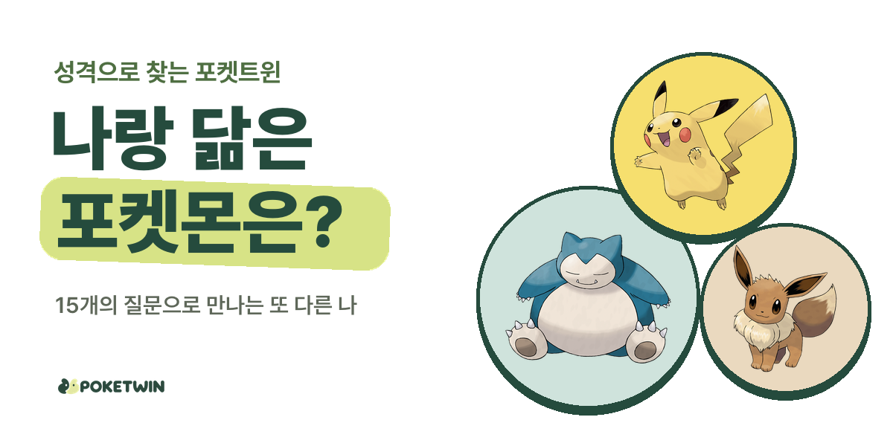
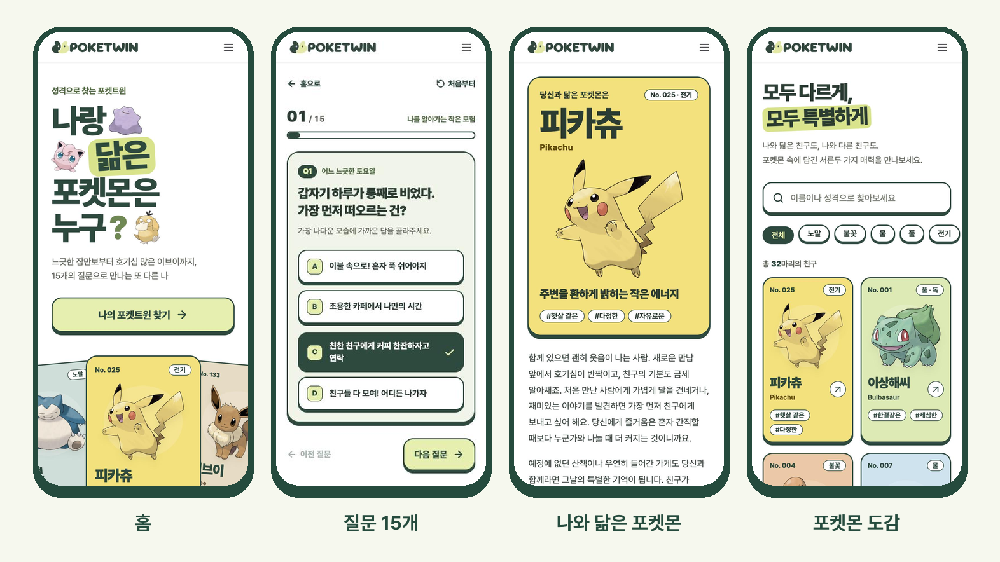
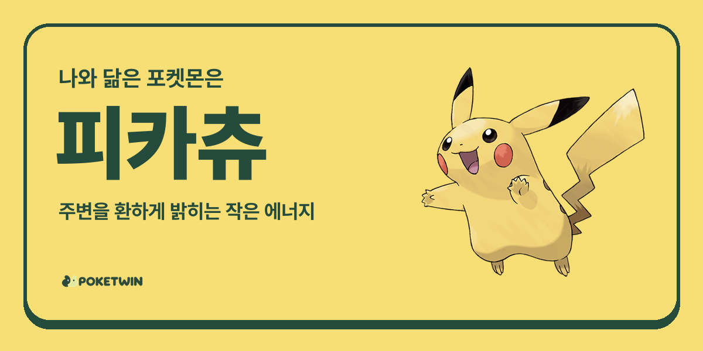
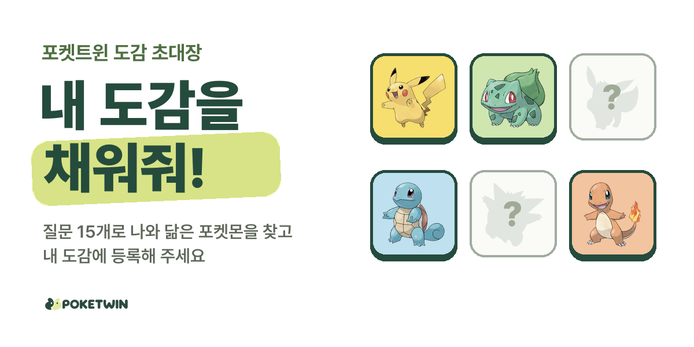
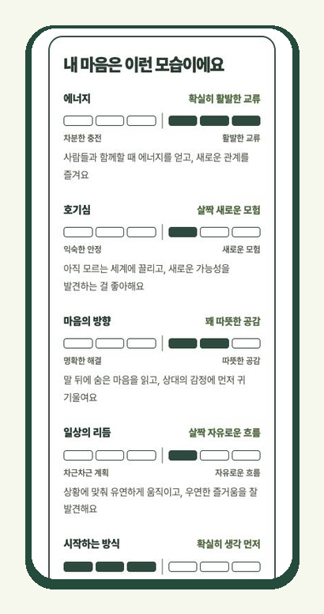
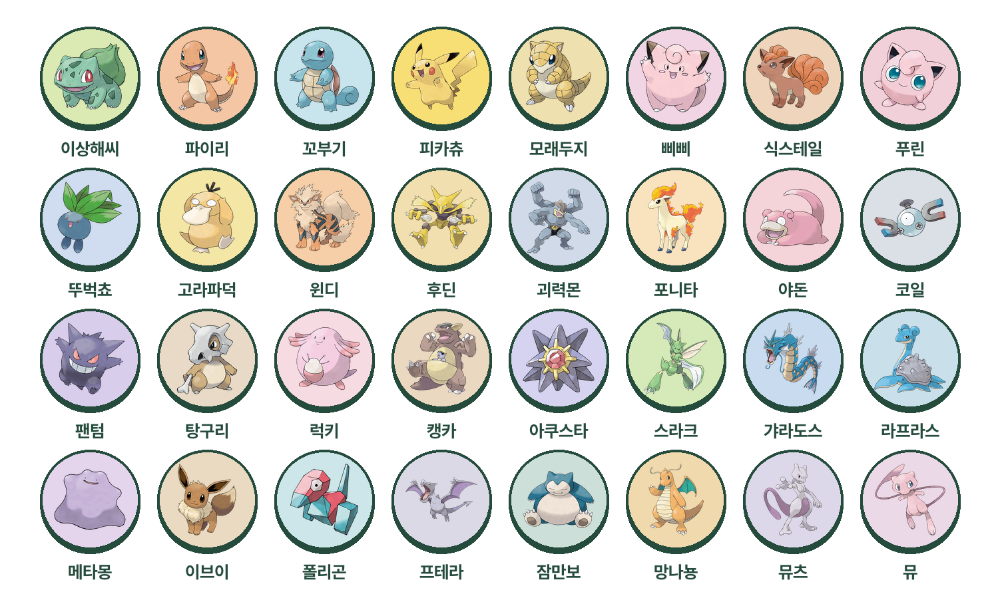
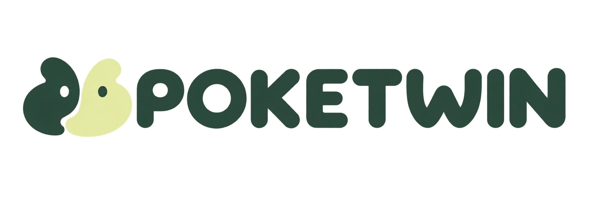

  

<h1 align="center">포켓트윈 · POKETWIN</h1>

  <b>15개의 질문으로 만나는 또 다른 나</b> 
  느긋한 잠만보부터 호기심 많은 이브이까지, 나와 꼭 닮은 포켓몬을 찾아보세요.

  <a href="https://poketwin.com"><b>👉 poketwin.com 에서 바로 해보기</b></a>

 

## 이런 서비스예요

쉬는 날을 보내는 방법, 친구의 고민을 듣는 순간, 여행을 준비하는 모습처럼 익숙한 일상 속 질문 15개에 답하면 32마리 포켓몬 중 나와 가장 닮은 친구를 찾아 줘요. 회원가입 없이 2분이면 충분해요.

  

## 이렇게 즐겨요

### 1. 질문 15개에 답해요

정답도, 더 좋은 성격도 없어요. 평소의 나를 떠올리며 가장 가까운 답을 골라 주세요. 중간에 그만둬도 다음에 이어서 풀 수 있어요.

### 2. 나와 닮은 포켓몬을 만나요

어떤 점이 닮았는지, 그 포켓몬다운 순간은 언제인지, 나에게 건네는 한마디까지 알려 줘요. 함께하면 좋은 **찰떡 파트너**와, 다르지만 그래서 재밌는 **티격태격 파트너**도 만나 보세요.

### 3. 친구에게 물어봐요

카카오톡, X, 인스타 스토리로 결과를 보내고 "너는 어떤 포켓몬일까?" 하고 물어보세요. 결과 카드를 그림으로 저장할 수도 있어요.

  

### 4. 친구들로 내 도감을 채워요

트레이너가 되어 초대 링크나 QR 코드를 보내 보세요. 친구가 테스트를 마칠 때마다 친구의 포켓몬이 내 도감에 하나씩 등록돼요. 친구에게도 도감이 있다면 서로의 도감에 함께 들어가요.

도감에 모인 친구 중 여섯 마리를 골라 **대표 파티**를 꾸리면, 우리 파티의 분위기와 찰떡·쌍둥이·정반대 같은 눈에 띄는 콤비를 알려 줘요. 두 사람을 골라 궁합도 비교해 보세요.

  

## 다섯 가지 성향

질문은 다섯 가지 성향을 세 개씩 살펴봐요. 다섯 성향이 각각 어느 쪽에 가까운지에 따라 32가지 조합이 생기고, 조합마다 포켓몬 한 마리가 짝지어져 있어요. 같은 답을 고르면 언제나 같은 포켓몬을 만나요.

<table>
  <tr>
    <td width="300" align="center"></td>
    <td>

| 성향 | 한쪽 | 다른 쪽 |
| --- | --- | --- |
| 에너지 | 차분한 충전 | 활발한 교류 |
| 호기심 | 익숙한 안정 | 새로운 모험 |
| 마음의 방향 | 명확한 해결 | 따뜻한 공감 |
| 일상의 리듬 | 차근차근 계획 | 자유로운 흐름 |
| 시작하는 방식 | 생각 먼저 | 행동 먼저 |

결과 화면에서는 성향마다 내가 어느 쪽에, 얼마나 가까운지 함께 보여 줘요.

</td>
  </tr>
</table>

## 32마리 친구들

  

  <a href="https://poketwin.com/collection">포켓몬 도감</a>에서 모두의 성향과 파트너를 둘러볼 수 있어요.

## 알려 드려요

- 포켓트윈은 Pokémon 공식 서비스와 제휴하지 않은 **비공식 팬 프로젝트**예요. 테스트 결과는 게임의 공식 성격 설정, 능력치, 타입 상성과 관계가 없고, 성향 해석과 파트너 조합은 심리 진단이 아니에요.
- Pokémon 및 관련 캐릭터의 권리는 Nintendo, Creatures, GAME FREAK 등 각 권리자에게 있어요.
- 포켓몬 이미지는 [PokeAPI/sprites](https://github.com/PokeAPI/sprites)의 공식 아트워크를, 트레이너 이미지는 Bulbagarden Archives에 수록된 포켓몬스터 레츠고! 피카츄·레츠고! 이브이 공식 일러스트를 사용해요. 글꼴은 [Pretendard](https://github.com/orioncactus/pretendard)(SIL Open Font License)예요.
- 어떤 정보를 저장하고 어떻게 지울 수 있는지는 [개인정보 처리방침](https://poketwin.com/privacy)에서 확인할 수 있어요.

 

   
  React · TypeScript · Vite · Supabase · Cloudflare Workers로 만들었어요

